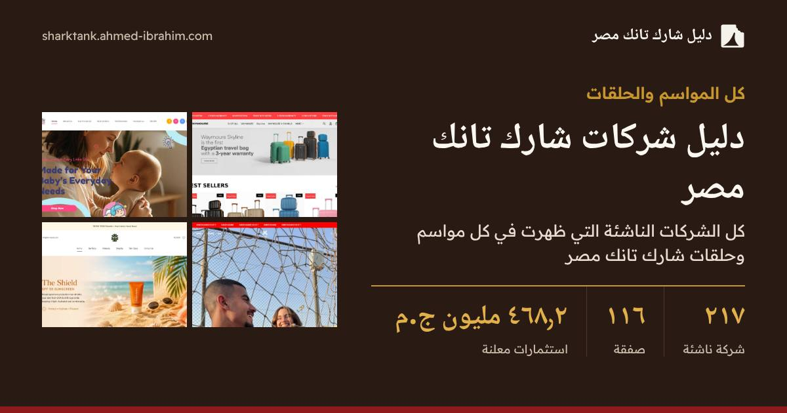

<div dir="rtl">

<div align="center">

[English](README.md) · **العربية**

<a href="https://sharktank.ahmed-ibrahim.com/"></a>

# دليل شارك تانك مصر

**كل الشركات والمستثمرين والمؤسسين والصفقات في شارك تانك مصر، بالعربية والإنجليزية.**

[](https://github.com/AhmadIbrahiim/SharkTankEgypt/actions/workflows/deploy.yml)
[](https://sharktank.ahmed-ibrahim.com/)
[](https://astro.build)

**[الموقع بالعربية](https://sharktank.ahmed-ibrahim.com/)** · **[الموقع بالإنجليزية](https://sharktank.ahmed-ibrahim.com/en/)** · **[أضف شركة أو صحّح معلومة](https://github.com/AhmadIbrahiim/SharkTankEgypt/issues/new?template=new-startup.yml)**

</div>

---

دليل مجتمعي غير رسمي لكل شركة ناشئة عرضت فكرتها في برنامج *شارك تانك مصر*: ‏220 شركة، و121 صفقة مسجّلة، و17 مستثمرًا، و5 مواسم بالإضافة إلى الحلقات الخاصة. كل صفحة متاحة بالعربية والإنجليزية، والمشروع كله يعمل على GitHub: البيانات في ملفات JSON، والموقع ثابت على GitHub Pages، والمهام الآلية على GitHub Actions.

## ماذا ستجد في الموقع

- **صفحة لكل شركة**: ماذا تقدّم، وخدماتها، وملخص العرض، والمبلغ المطلوب والصفقة النهائية، والمؤسسون، والموقع الإلكتروني وحسابات التواصل، وصورة من الموقع أو فيديو العرض، والتعليقات.
- **صفحة لكل مستثمر (شارك)**: محفظته، وما استثمره، ومتوسط الحصة، والقطاعات المفضّلة، ومن يستثمر معه، وصفقاته حسب الموسم والقطاع.
- **صفحة لكل مؤسس**: شركاته، وشركاؤه، وكيف سار العرض.
- **الحلقات والمواسم والقطاعات**: من عرض، ومن استثمر، وأكبر المبالغ المطلوبة وأكبر الصفقات.
- **مقارنة بين المستثمرين** و**قوائم ترتيب**: أكبر الصفقات، وأعلى التقييمات، والصفقات المشتركة، والشركات التي خرجت بدون صفقة، وغيرها.
- **أكثر من 10,000 سؤال وجواب** باللغتين، بما فيها صيغ باللهجة المصرية.
- **كل الصفقات** مع تحليلات (متوسط الصفقة والوسيط والتقييمات والصفقات حسب القطاع)، وشرح للمنهجية، وحاسبة للتقييم.
- **مقارنة الشركات** جنبًا إلى جنب، وشركات مشابهة في كل صفحة.
- **حالة التحقق** وتاريخ آخر مراجعة لكل شركة، مأخوذة من مصادرها.
- **بيانات مفتوحة**: [CSV](https://sharktank.ahmed-ibrahim.com/data/deals.csv) و[JSON](https://sharktank.ahmed-ibrahim.com/data/startups.json) و[llms.txt](https://sharktank.ahmed-ibrahim.com/llms.txt).
- **صورة مشاركة** مولّدة لكل صفحة، وبيانات منظّمة كاملة بصيغة schema.org.

## كيف يعمل المشروع

| الجزء | المكان |
|---|---|
| البيانات | `src/data/*.json`: الشركات، والأشخاص (المستثمرون والمؤسسون)، والمواسم، والأسماء العربية. يُتحقق منها بـ `npm run check-data` وتُراجع بـ `npm run audit-data` (انظر [DATA_QUALITY_REPORT.md](DATA_QUALITY_REPORT.md)) مع كل نشر. |
| الموقع | موقع ثابت مبني بـ [Astro](https://astro.build) (حوالي 1,480 صفحة)، يُنشر على فرع `gh-pages` عبر `.github/workflows/deploy.yml`. |
| صور المشاركة | `scripts/og.mjs` يرسم بطاقة 1200×630 لكل صفحة باستخدام Playwright بعد كل بناء. |
| صور المواقع | `.github/workflows/screenshots.yml` يلتقط صورة لموقع كل شركة أسبوعيًا وكلما تغيّرت البيانات. |
| أدوات البحث | مهام `harvest` و`photos` و`enrich` تجمع المواد الخام في `automation/`. لا يصل شيء منها إلى الموقع قبل أن يراجعه شخص. |
| الفحوصات | اختبارات الوحدات (`npm test`)، وفحص SEO والروابط (`npm run audit-seo`)، واختبارات المتصفح بـ Playwright (`npm run e2e`)، ولا يتم النشر إلا إذا نجحت كلها. |
| التعليقات والتفاعلات | [giscus](https://giscus.app): نقاش واحد على GitHub Discussions لكل شركة، مشترك بين اللغتين. |
| SEO | العربية في جذر الموقع والإنجليزية تحت `/en/` مع `hreflang` (الروابط القديمة `/ar/` تُحوَّل تلقائيًا)، وخريطة موقع، ورسم JSON-LD مترابط لكل صفحة (WebSite وOrganization وPerson/ProfilePage وTVSeries/TVSeason/TVEpisode وBreadcrumbList وFAQPage). |

## المساهمة

التصحيحات والمعلومات الجديدة مرحّب بها جدًا، خصوصًا نتائج الصفقات وأسماء المؤسسين والروابط. انظر [CONTRIBUTING.md](CONTRIBUTING.md). أسرع طريقة هي نموذج **[أضف شركة أو صحّح معلومة](https://github.com/AhmadIbrahiim/SharkTankEgypt/issues/new?template=new-startup.yml)**، ولا يحتاج إلى أي برمجة.

## التشغيل محليًا

</div>

```sh
npm install
npm run dev          # http://localhost:4321/
npm run check-data   # validate src/data
npm run audit-data   # contradictions and gaps -> DATA_QUALITY_REPORT.md
npm test             # unit tests
npm run build && npm run audit-seo && npm run e2e   # build, SEO/link audit, browser tests
node scripts/og.mjs  # share images
```

<div dir="rtl">

عنوان الموقع موجود في مكان واحد: الحقل `homepage` في `package.json`.

تقارير المراجعة: [AUDIT_REPORT.md](AUDIT_REPORT.md) · [SEO_AUDIT.md](SEO_AUDIT.md) · [PERFORMANCE_REPORT.md](PERFORMANCE_REPORT.md) · [IMPLEMENTATION_PLAN.md](IMPLEMENTATION_PLAN.md)

## الترخيص

الكود: [MIT](LICENSE). البيانات في `src/data/`: ‏[CC BY 4.0](src/data/LICENSE.md). يُرجى ذكر الدليل كمصدر إذا أعدت استخدامها. الصور ولقطات المواقع ملك أصحابها.

## إخلاء مسؤولية

هذا مشروع مستقل من المعجبين والمجتمع، وليس تابعًا لبرنامج Shark Tank أو Sony Pictures Television أو CBC أو WATCH IT. المعلومات مأخوذة من مصادر عامة مذكورة في صفحة كل شركة. إذا كنت مؤسسًا وتريد تعديل معلوماتك أو حذفها، [افتح طلبًا هنا](https://github.com/AhmadIbrahiim/SharkTankEgypt/issues/new).

</div>
