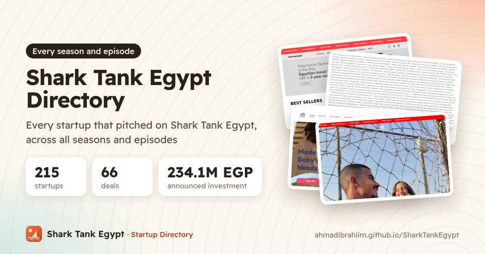

<div align="center">

**English** · [العربية](README.ar.md)

<a href="https://sharktank.ahmed-ibrahim.com/"></a>

# Shark Tank Egypt Directory

**Every startup, shark, founder and deal from Shark Tank Egypt, in Arabic and English.**

[](https://github.com/AhmadIbrahiim/SharkTankEgypt/actions/workflows/deploy.yml)
[](https://sharktank.ahmed-ibrahim.com/)
[](https://astro.build)

**[Website (Arabic)](https://sharktank.ahmed-ibrahim.com/)** · **[Website (English)](https://sharktank.ahmed-ibrahim.com/en/)** · **[Add or fix a startup](https://github.com/AhmadIbrahiim/SharkTankEgypt/issues/new?template=new-startup.yml)**

</div>

---

An unofficial, community-run directory of every startup that pitched on *Shark Tank Egypt* (شارك تانك مصر): 220 startups, 128 recorded deals, 17 sharks and 5 seasons plus the specials. Every page is available in Arabic and English, and the whole thing runs on GitHub: data in JSON, a static site on Pages and automation in Actions.

## What's inside

- **Startup pages**: what they do, their services, a pitch summary, the ask and the final deal, founders, website and socials, a screenshot or the pitch video, and comments.
- **Shark profiles**: portfolio, money invested, average equity, favourite sectors, co-investors, and deals by season and by sector.
- **Founder profiles**: their companies, co-founders and how the pitch went.
- **Episodes, seasons and sectors**: who pitched, who invested, and the biggest asks and deals.
- **Shark vs shark** comparisons and **rankings**: biggest deals, highest valuations, joint deals, startups that got no deal, and more.
- **10,000+ questions answered** (FAQ) in both languages, including Egyptian-dialect phrasing.
- **All deals** with analytics (average and median deal, valuations, deals by sector), a methodology note and a valuation calculator.
- **Compare startups** side by side, and related startups on every page.
- A **verification status** and last-checked date on every startup, derived from its sources.
- **Open data**: [CSV](https://sharktank.ahmed-ibrahim.com/data/deals.csv), [JSON](https://sharktank.ahmed-ibrahim.com/data/startups.json) and [llms.txt](https://sharktank.ahmed-ibrahim.com/llms.txt).
- A generated **share image** for every page, and full **schema.org** structured data.

## How it works

| Piece | Where |
|---|---|
| Data | `src/data/*.json`: startups, people (sharks and founders), seasons, Arabic names. Validated by `npm run check-data` and audited by `npm run audit-data` (see [DATA_QUALITY_REPORT.md](DATA_QUALITY_REPORT.md)) on every deploy. |
| Site | [Astro](https://astro.build) static build (about 1,480 pages), published to the `gh-pages` branch by `.github/workflows/deploy.yml`. |
| Share images | `scripts/og.mjs` renders a 1200×630 card per page with Playwright after each build. |
| Screenshots | `.github/workflows/screenshots.yml` captures each startup's website weekly and whenever the data changes. |
| Research helpers | The `harvest`, `photos` and `enrich` workflows collect raw material into `automation/`. Nothing there reaches the site until a person reviews it. |
| Checks | Unit tests (`npm test`), an SEO and link audit (`npm run audit-seo`) and Playwright end-to-end tests (`npm run e2e`) gate every deploy. |
| Comments and reactions | [giscus](https://giscus.app): one GitHub Discussion per startup, shared by both languages. |
| SEO | Arabic at the root and English under `/en/`, with `hreflang` (old `/ar/` links redirect), a sitemap, one linked JSON-LD graph per page (WebSite, Organization, Person/ProfilePage, TVSeries/TVSeason/TVEpisode, BreadcrumbList, FAQPage). |

## Contributing

Corrections and new information are very welcome, especially deal outcomes, founder names and links. See [CONTRIBUTING.md](CONTRIBUTING.md). The quickest way is the **[Add or fix a startup](https://github.com/AhmadIbrahiim/SharkTankEgypt/issues/new?template=new-startup.yml)** form, which needs no code.

## Local development

```sh
npm install
npm run dev          # http://localhost:4321/
npm run check-data   # validate src/data
npm run audit-data   # contradictions and gaps -> DATA_QUALITY_REPORT.md
npm test             # unit tests
npm run build && npm run audit-seo && npm run e2e   # build, SEO/link audit, browser tests
node scripts/og.mjs  # share images
```

The site address lives in one place, `homepage` in `package.json`.

Audit reports: [AUDIT_REPORT.md](AUDIT_REPORT.md) · [SEO_AUDIT.md](SEO_AUDIT.md) · [PERFORMANCE_REPORT.md](PERFORMANCE_REPORT.md) · [IMPLEMENTATION_PLAN.md](IMPLEMENTATION_PLAN.md)

## License

Code: [MIT](LICENSE). Data in `src/data/`: [CC BY 4.0](src/data/LICENSE.md). Please credit the directory if you reuse it. Photos and screenshots belong to their owners.

## Disclaimer

This is an independent fan and community project. It is not affiliated with Shark Tank, Sony Pictures Television, CBC or WATCH IT. Facts come from public sources, which are listed on each startup page. Founders who would like their information changed or removed can [open an issue](https://github.com/AhmadIbrahiim/SharkTankEgypt/issues/new).
